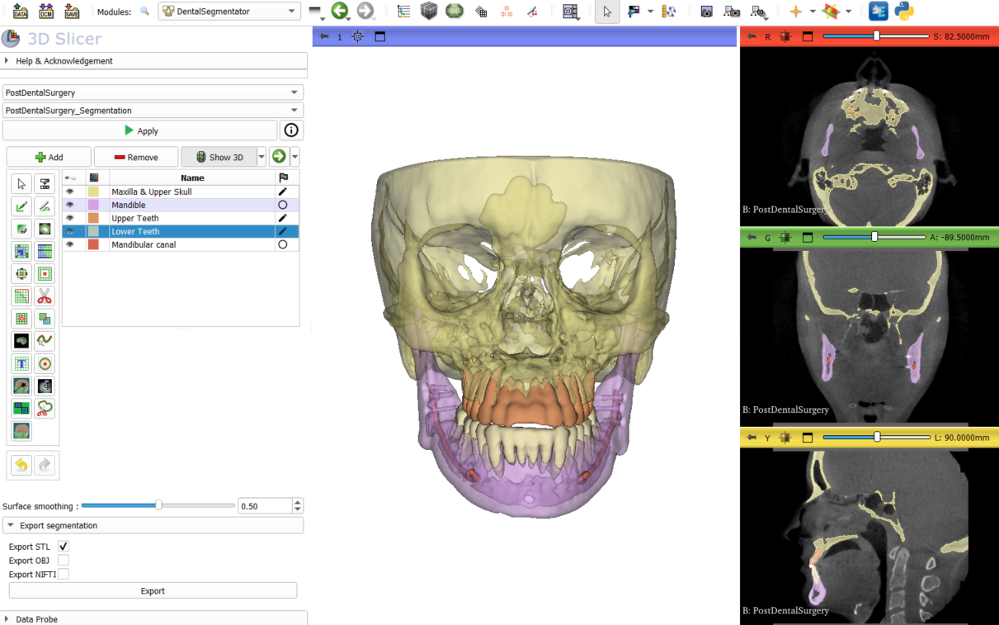
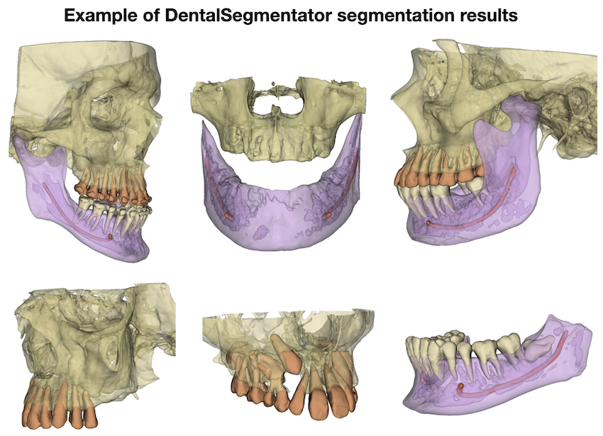
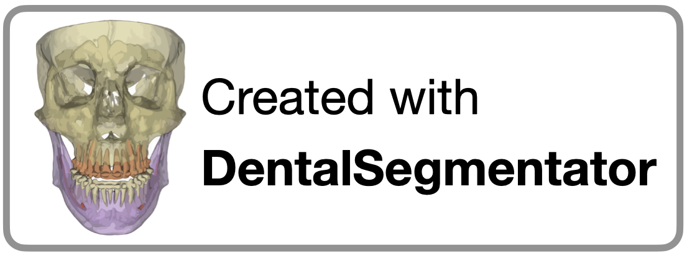
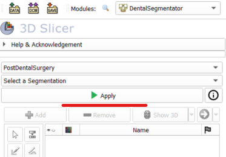
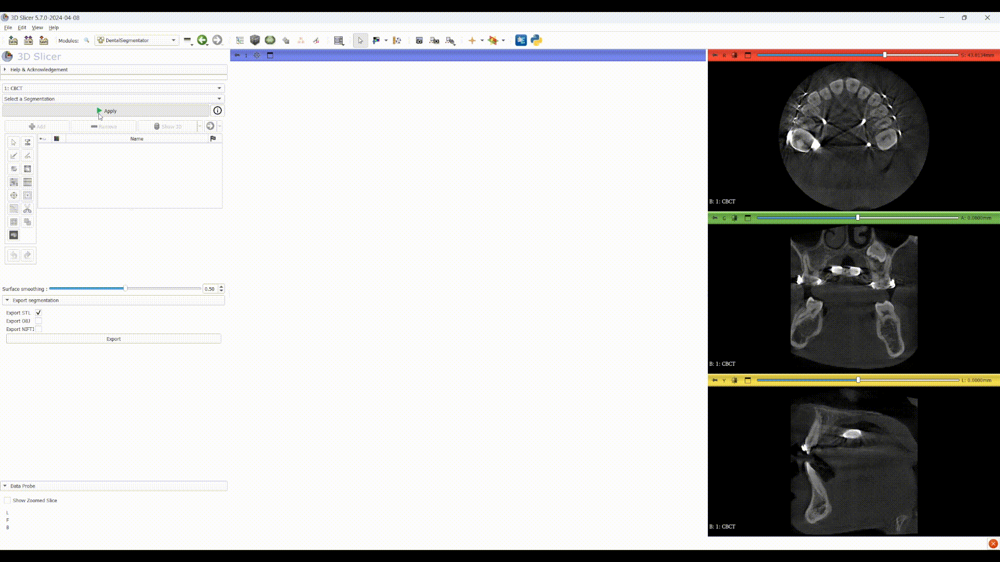
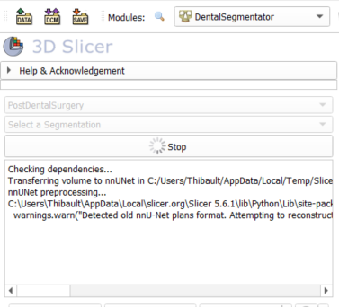
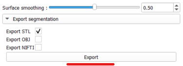
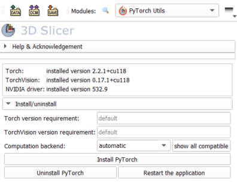
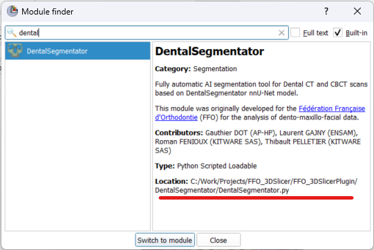

# Slicer DentalSegmentator

**Fully automatic AI-powered segmentation of dental CT and CBCT images in 3D Slicer.**

DentalSegmentator is an open-source deep learning extension for **automatic multiclass segmentation of dento-maxillo-facial CT and CBCT scans**. Built on the nnU-Net framework, it provides robust segmentation of dental and craniofacial anatomical structures, regardless of the scan field of view.

<p align="center">
  
</p>

<p align="center">
  <b>Open-source · Deep Learning · Fully Automatic · Head CT & CBCT</b>
</p>

---

## ✨ Key Features

DentalSegmentator automatically generates five anatomical segmentations from a single CT or CBCT volume:
- Maxilla & Upper Skull
- Mandible
- Upper Teeth
- Lower Teeth
- Mandibular Canal 

**Why DentalSegmentator?**

- **Fully automatic:** No manual initialization or annotation required.
- **Multiclass segmentation:** Multiple anatomical structures segmented in a single workflow.
- **Robust performance:** Evaluated across diverse CT and CBCT datasets.
- **Open source:** Integrated directly into 3D Slicer.
- **Research-ready:** Segmentation results can be refined, visualized, and exported for further analysis.

## 🧠 The DentalSegmentator Model

DentalSegmentator is based on the **[nnU-Net](https://github.com/MIC-DKFZ/nnUNet) framework**, a self-configuring deep learning framework for biomedical image segmentation.

### Training & Evaluation

- **Training dataset:** 470 dento-maxillo-facial CT and CBCT scans.
- **Independent evaluation:** 256 CT and CBCT scans.
- **Data diversity:** Test data collected from 7 different institutions.

Results obtained on this highly diversified dataset demonstrate robust, fully automatic multiclass segmentation of dento-maxillo-facial CT and CBCT scans, independently of the field of view.

<p align="center">
  
</p>

If you use DentalSegmentator in your research, please cite the following publications:

**DentalSegmentator**

> Dot G, et al. DentalSegmentator: robust open source deep learning-based CT and CBCT image segmentation. *Journal of Dentistry* (2024).
> https://doi.org/10.1016/j.jdent.2024.105130

**nnU-Net**

> Isensee F, et al. nnU-Net: a self-configuring method for deep learning-based biomedical image segmentation. *Nature Methods*. 2021;18(2):203–211.
> https://doi.org/10.1038/s41592-020-01008-z

We also strongly encourage you to use the following badge when displaying models generated with this extension:

<p align="center">
  
</p>

---

## 🚀 Getting Started

### 1. Requirements

DentalSegmentator is compatible with:

- **[3D Slicer](https://download.slicer.org/):** Version 5.8.0 or later (latest stable release).
- **Input data:** Head or Dental CT or CBCT volumes.

### 2. Installation

The extension can be installed directly from the 3D Slicer Extension Manager.

1. Download and launch [3D Slicer](https://download.slicer.org/).
2. Open the [Extension Manager](https://slicer.readthedocs.io/en/latest/user_guide/extensions_manager.html#install-extensions).
3. Search for `DentalSegmentator`.
4. Install the extension.
5. Restart 3D Slicer.

After restarting, you can access the extension through:

`Segmentation → DentalSegmentator`

Alternatively, use the module search button and type `DentalSegmentator`.

### 3. Quick Start Guide

Getting started takes just a few steps:

**Step 1 — Load your data**

Load a dental CT or CBCT volume into 3D Slicer using drag-and-drop or the `DATA` / `DCM` buttons.

💡 *Want to try the extension without importing your own data? Use the CBCT Dental Surgery sample volumes available in the 3D Slicer Sample Data module.*

**Step 2 — Select the module**

Navigate to the `DentalSegmentator` module and select your input volume from the first dropdown menu.

**Step 3 — Run segmentation**

Click `Apply` to launch the automatic segmentation.

<p align="center">
  
</p>

### 4. First-Time Setup & Processing

During the first launch, the module automatically installs its required dependencies, including:

- AI model weights
- PyTorch Lightning
- PyTorch
- nnU-Net v2

Once installed, the input volume is transferred to the nnU-Net v2 library for processing.

**GPU acceleration:** CUDA-compatible devices can accelerate inference. If CUDA is unavailable, processing may take significantly longer. A confirmation dialog will appear before starting CPU-based processing.

<p align="center">
  
</p>

During processing:

- Click `Stop` to cancel the segmentation.
- Monitor processing progress through the console logs.

<p align="center">
  
</p>

### 5. Post-Processing & Export

Once segmentation is complete, the results are automatically loaded into 3D Slicer.

You can further refine the segmentation using the built-in **Segment Editor** tools.

<p align="center">
  
</p>

Available options include:

- **Export segmentation:** Choose your preferred export format using the `Export segmentation` menu.
- **Surface smoothing:** Adjust the `Surface smoothing` slider to modify the smoothing algorithm applied to the 3D surface representation.

<p align="center">
  
</p>

---

## 📊 Scientific Validation

DentalSegmentator has been evaluated in several independent research studies addressing different anatomical structures and clinical research applications.

### Impacted Teeth

DentalSegmentator has demonstrated reliability in segmenting multiple impacted teeth, including cases associated with rare diseases.

> Sinard E, et al. Automated Cone Beam Computed Tomography Segmentation of Multiple Impacted Teeth With or Without Association to Rare Diseases: Evaluation of Four Deep Learning-Based Methods. *Orthodontics & Craniofacial Research*. 2025;28(3):433–440.
> https://doi.org/10.1111/ocr.12890

### Mandibular Canal Segmentation

High reliability has been demonstrated for mandibular canal segmentation.

> Shujaat S, et al. Comparative analysis of five AI platforms for mandibular canal segmentation on CBCT images. *Journal of Dentistry*. 2026;166:106345.
> https://doi.org/10.1016/j.jdent.2026.106345

### Facial Skeletal Surface Models

An ex vivo study demonstrated high accuracy for facial bone segmentation across diverse CT and CBCT acquisition settings, including ultra-low-dose CBCT.

> Gkantidis N, et al. Accuracy and generalizability of an open-source deep learning model for facial bone segmentation on CT and CBCT scans: An ex vivo study. *Journal of Dentistry*. 2026;170:106663.
> https://doi.org/10.1016/j.jdent.2026.106663

### Tooth Segmentation 

In an ex vivo pilot study, DentalSegmentator demonstrated similar tooth segmentation trueness to commercial solutions.

> Reymus M, et al. Trueness of artificial intelligence-driven CBCT tooth segmentation: A comparative validation ex vivo pilot study. *Journal of Dentistry*. 2026;169:106613.
> https://doi.org/10.1016/j.jdent.2026.106613

---

## 🔬 Research Applications

DentalSegmentator can support a wide range of clinical and translational research projects involving dental and craniofacial imaging.

The following publications illustrate some of its potential applications.

### Quantification of Root Resorption

- Bespalez-Neto R, et al. Quantifying Root Resorption on the Incisors After Clear Aligner and Fixed Appliance Therapy Using Artificial Intelligence Tool Based CBCT Surface Models: Randomized Clinical Trial. *Orthodontics & Craniofacial Research*. 2026;29(2):366–374.
  https://doi.org/10.1111/ocr.70082

- Taneja S, et al. Evaluation of orthodontically induced inflammatory root resorption (OIIRR) in adolescent patients with class II malocclusion undergoing treatment with rigid and hybrid fixed functional appliances: a randomized clinical trial. *Clinical Oral Investigations*. 2026;30.
  https://doi.org/10.1007/s00784-026-06482-1

### Guided Tooth Autotransplantation

- Salviati M, et al. A novel full digital workflow for dental autotransplantation: surgical accuracy and clinical outcomes in a prospective cohort study. *Frontiers in Oral Health*. 2026;7.
  https://doi.org/10.3389/froh.2026.1554101

- Chen G, et al. Evaluation of the Effectiveness of an AI-assisted, Dual-Template Workflow in Improving the Accuracy of Tooth Autotransplantation. *International Dental Journal*. 2026;76(3):109460.
  https://doi.org/10.1016/j.identj.2026.109460

### Condylar Volume & TMJ Anatomy

- Jia W, et al. Fully automated evaluation of condylar remodeling after orthognathic surgery in skeletal class II patients using deep learning and landmarks. *Journal of Dentistry*. 2025;159:105819.

- Oğuz F, et al. Evaluation of Condylar and Airway Volume in Skeletal Class I Patients with Different Vertical Growth Patterns. *Applied Sciences*. 2025;15(5):2794.

- Oğuz F, Özden S. Three-Dimensional Evaluation of TMJ Morphology in Individuals with Maxillary or Mandibular Impacted Canines: A CBCT-Based Retrospective Study. *Diagnostics*. 2026;16(3):496.

### Guided Endodontics

- Zhang Y, et al. EndoPlanner: An adaptive planning framework for root canal therapy with graph-based endodontic landmark detection and inference-time refinement. *Medical Image Analysis*. 2027;115:104294.
  https://doi.org/10.1016/j.media.2026.104294

### Orbital Surgery Planning

- Zhang C, et al. SlicerOrbitSurgerySim: An Open-Source Platform for Virtual Registration and Quantitative Comparison of Preformed Orbital Plates. *Journal of Oral and Maxillofacial Surgery*. 2026;84:1614–1621.
  https://doi.org/10.1016/j.joms.2026.04.020

---

## 🛠️ Troubleshooting

### General Troubleshooting

If you encounter problems during installation or execution, we recommend the following steps:

1. Verify that the PyTorch extension is installed and functional.
2. Check that the model files are present in the expected directory.
3. Restart 3D Slicer and reload the module.
4. Test the extension using the sample data provided by 3D Slicer.
5. Review the console logs for Python errors or missing dependencies.

### macOS — GPU Acceleration

Due to ongoing compatibility issues between macOS and PyTorch, GPU acceleration is currently unavailable on Apple Silicon/macOS devices.

### Linux / WSL — Processing Hang

On Linux or WSL systems, inference may get stuck at the `"done with volume"` stage.

This generally indicates an out-of-memory (OOM) error.

**Recommended solution:**

- A minimum of 32 GB RAM is recommended to run this extension.
- If the problem persists, creating a 16 GB SWAP file on an SSD should resolve the issue.

### Windows — CUDA Not Properly Installed

In some cases, the PyTorch CUDA dependency may not be detected or installed automatically.

To resolve this issue:

1. Open the `PyTorch Utils` extension.
2. Uninstall the currently installed version of PyTorch.
3. Install PyTorch again, selecting the `Computation backend` compatible with your hardware.

⚠️ **Important:** PyTorch version must be greater than `2.0.0` for nnU-Net compatibility.

<p align="center">
  
</p>

### Failed to Download or Find Model Weights

If the model weights cannot be downloaded or installed automatically, they can be installed manually.

**Manual installation:**

1. Visit the [GitHub Releases page](https://github.com/gaudot/SlicerDentalSegmentator/releases).
2. Download the latest `.zip` file from the release.
3. Locate your `DentalSegmentator` folder using the module finder window.

<p align="center">
  
</p>

4. Extract the downloaded weights into:

   `DentalSegmentator/Resources/ML`

5. Create a `download_info.json` file containing the download URL for future reference:

```json
{
  "download_url": "https://github.com/gaudot/SlicerDentalSegmentator/releases/download/v1.0.0-alpha/Dataset111_453CT_v100.zip"
}
```

---

## 💻 Command-Line Interface

DentalSegmentator can also be used independently of the 3D Slicer graphical interface through the nnU-Net command-line interface.

The pretrained model is available on Zenodo:

👉 [Download the pretrained model from Zenodo](https://zenodo.org/doi/10.5281/zenodo.10829674)

---

## 🤝 Contributing

Contributions from the community are welcome!

If you are interested in improving DentalSegmentator, reporting issues, or contributing new features, please refer to our contribution guidelines:

👉 [CONTRIBUTING.md](CONTRIBUTING.md)

---

## Acknowledgments

**Authors**

- G. Dot — Université Paris Cité, AP-HP, Arts-et-Métiers
- L. Gajny — Arts-et-Métiers
- R. Fenioux — Kitware SAS
- T. Pelletier — Kitware SAS

**Funding & Support**

This project was supported by:

- [FFO — Fédération Française d'Orthodontie](https://orthodontie-ffo.org/)
- [Fondation des Gueules Cassées](https://www.gueules-cassees.asso.fr/)

---

<p align="center">
  <b>DentalSegmentator</b><br/>
  Open-source AI for dental and craniofacial image segmentation.
  <br/><br/>
  ⭐ If you find this project useful, consider giving it a star on GitHub!
</p>
