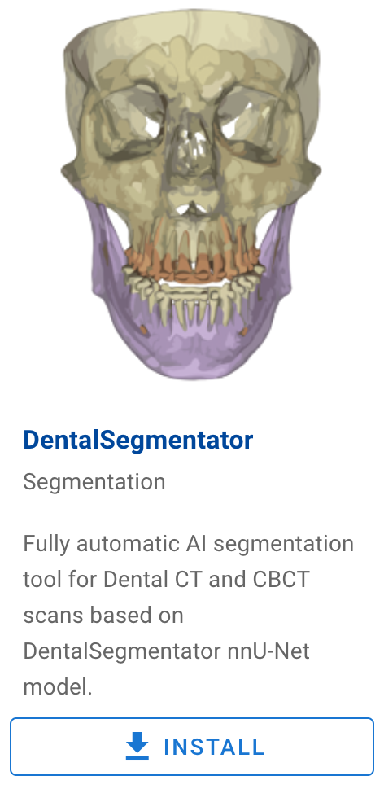

# Slicer DentalSegmentator 

3D Slicer extension for fully-automatic segmentation of CT and CBCT dental volumes.


After loading and selecting the volume to process, this module generates the following segmentations: 
- Maxilla & Upper Skull
- Mandible
- Upper Teeth
- Lower Teeth
- Mandibular canal

## DentalSegmentator Model

DentalSegmentator is based on the nnU-Net framework. It has been trained on 470 dento-maxillo-facial CT and CBCT scans and evaluated on a hold-out test dataset of 256 CT and CBCT scans from 7 institutions. 

The results obtained on our highly diversified dataset demonstrate that our tool can provide fully automatic and robust multiclass segmentation for dento-maxillo-facial (CB)CT scans, independently of the field of view of the scan.


If you use DentalSegmentator for your work, please cite our paper and nnU-Net:

> Dot G, et al. DentalSegmentator: robust open source deep learning-based CT and CBCT image segmentation. Journal of Dentistry (2024) doi:[10.1016/j.jdent.2024.105130](https://doi.org/10.1016/j.jdent.2024.105130)

> Isensee F, et al. nnU-Net: a self-configuring method for deep learning-based biomedical image segmentation. Nat Methods. 2021;18(2):203-211. doi:[10.1038/s41592-020-01008-z](https://doi.org/10.1038/s41592-020-01008-z)

We also strongly encourage you to use this badge when displaying models created with this extension:


## Using the Extension

[Watch the video tutorial](https://www.youtube.com/watch?v=BEG-XhjjiaY) for a walkthrough of the installation process and a demonstration of the extension's main capabilities.

This extension is compatible with the latest 3D Slicer Stable Release (version 5.8.0 or later), downloadable [from the official website](https://download.slicer.org/). 

The plugin can be installed in Slicer using the [Extension Manager](https://slicer.readthedocs.io/en/latest/user_guide/extensions_manager.html#install-extensions). Search for "DentalSegmentator" in the search bar.



After installation and restarting Slicer, the extension can be found in the module file explorer under `Segmentation > DentalSegmentator`, or by using the search module button and typing `DentalSegmentator`.

### Quick Start Guide

1. **Load Data**: Load a dental CT or CBCT by drag-and-dropping the data into 3D Slicer or by using the `DATA` or `DCM` load buttons. 
   *(To test the extension quickly, you can use 3D Slicer's `CBCT Dental Surgery` volumes found in the `Sample Data` module).*
2. **Select Module**: Switch to the `DentalSegmentator` module and select your volume in the first dropdown menu.
3. **Run Segmentation**: Click the `Apply` button to start the segmentation.


During the first launch, the module's dependencies will be installed automatically. These include:
- The AI model weights
- PyTorch Lightning
- PyTorch
- nnU-Net v2

Once installed, the volume is transferred and processed by the nnU-Net v2 library. If your device does not include CUDA, processing may take a significant amount of time, and a confirmation dialog will appear before starting.


During execution, processing can be canceled using the `Stop` button, and progress can be monitored in the console logs.


### Post-Processing & Export

Once complete, the segmentation is loaded into the application and can be refined using the `Segment Editor` tools.


- **Export**: Use the `Export segmentation` menu to select your desired export format.
- **Surface Smoothing**: Adjust the `Surface smoothing` slider to modify the 3D view surface smoothing algorithm.


## Model Evaluation

**Multiple Impacted Teeth**: DentalSegmentator has been shown to be reliable to segment multiple impacted teeth, with or without association to rare diseases.
  > Sinard E, Gajny L, de La Dure-Molla M, Felizardo R, Dot G. Automated Cone Beam Computed Tomography Segmentation of Multiple Impacted Teeth With or Without Association to Rare Diseases: Evaluation of Four Deep Learning-Based Methods. *Orthod Craniofac Res.* 2025;28(3):433-440. doi:[10.1111/ocr.12890](https://doi.org/10.1111/ocr.12890)

**Mandibular Canal**: DentalSegmentator has been shown to be highly reliable for mandibular canal segmentation.
  > Shujaat S, et al. Comparative analysis of five AI platforms for mandibular canal segmentation on CBCT images. *J Dent.* 2026;166:106345. doi:[10.1016/j.jdent.2026.106345](https://doi.org/10.1016/j.jdent.2026.106345)

**Facial Skeletal Surface Models**: DentalSegmentator has been shown to provide highly accurate facial skeletal surface models across diverse CT and CBCT settings (including ultra-low dose CBCT) in an ex vivo study.
  > Gkantidis N, Ghamri M, Dot G. Accuracy and generalizability of an open-source deep learning model for facial bone segmentation on CT and CBCT scans: An ex vivo study. *J Dent.* 2026;170:106663. doi:[10.1016/j.jdent.2026.106663](https://doi.org/10.1016/j.jdent.2026.106663)

**Tooth Segmentation Trueness**: DentalSegmentator has shown a similar trueness to that of commercial solutions for tooth segmentation in an ex vivo pilot study.
  > Reymus M, et al. Trueness of artificial intelligence-driven CBCT tooth segmentation: A comparative validation ex vivo pilot study. *J Dent.* 2026;169:106613. doi:[10.1016/j.jdent.2026.106613](https://doi.org/10.1016/j.jdent.2026.106613)

## Use Cases Examples

Without any exhaustivity, here are some use cases examples of DentalSegmentator to assist clinical research.

**Quantification of root resorptions**
  > Bespalez-Neto R, et al. Quantifying Root Resorption on the Incisors After Clear Aligner and Fixed Appliance Therapy Using Artificial Intelligence Tool Based CBCT Surface Models: Randomized Clinical Trial. *Orthod Craniofac Res.* 2026;29(2):366–374. doi:[10.1111/ocr.70082](https://doi.org/10.1111/ocr.70082)

  > Taneja S, Batra P, Talwar A, Singla A, Srivastava M. Evaluation of orthodontically induced inflammatory root resorption (OIIRR) in adolescent patients with class II malocclusion undergoing treatment with rigid and hybrid fixed functional appliances: a randomized clinical trial. *Clin Oral Invest.* 2026;30. doi:[10.1007/s00784-026-06482-1](https://doi.org/10.1007/s00784-026-06482-1)

**Segmentation of CBCT scans for guided tooth autotransplantation**
  > Salviati M, et al. A novel full digital workflow for dental autotransplantation: surgical accuracy and clinical outcomes in a prospective cohort study. *Front Oral Health.* 2026;7. doi:[10.3389/froh.2026.1554101](https://doi.org/10.3389/froh.2026.1554101)

  > Chen G, et al. Evaluation of the Effectiveness of an AI-assisted, Dual-Template Workflow in Improving the Accuracy of Tooth Autotransplantation. *Int Dent J.* 2026;76(3):109460. doi:[10.1016/j.identj.2026.109460](https://doi.org/10.1016/j.identj.2026.109460)

**Assess condylar volume and TMJ anatomy**
  > Jia W, et al. Fully automated evaluation of condylar remodeling after orthognathic surgery in skeletal class II patients using deep learning and landmarks. *J Dent.* 2025;159:105819. doi:[10.1016/j.jdent.2025.105819](https://doi.org/10.1016/j.jdent.2025.105819)

  > Oğuz F, Bor S, Khanmohammadi A, Kıranşal M. Evaluation of Condylar and Airway Volume in Skeletal Class I Patients with Different Vertical Growth Patterns. *Appl Sci.* 2025;15(5):2794. doi:[10.3390/app15052794](https://doi.org/10.3390/app15052794)

  > Oğuz F, Özden S. Three-Dimensional Evaluation of TMJ Morphology in Individuals with Maxillary or Mandibular Impacted Canines: A CBCT-Based Retrospective Study. *Diagnostics.* 2026;16(3):496. doi:[10.3390/diagnostics16030496](https://doi.org/10.3390/diagnostics16030496)

**Assist guided endodontics**
  > Zhang Y, Kong F, Wang K, Huang Z, Chen X. EndoPlanner: An adaptive planning framework for root canal therapy with graph-based endodontic landmark detection and inference-time refinement. *Med Image Anal.* 2027;115:104294. doi:[10.1016/j.media.2026.104294](https://doi.org/10.1016/j.media.2026.104294)

**Assist the preparation and evaluation of orbital surgery plates**
  > Zhang C, Gunn B, Read-Fuller AM. SlicerOrbitSurgerySim: An Open-Source Platform for Virtual Registration and Quantitative Comparison of Preformed Orbital Plates. *J Oral Maxillofac Surg.* 2026;84:1614–1621. doi:[10.1016/j.joms.2026.04.020](https://doi.org/10.1016/j.joms.2026.04.020)

## Troubleshooting

### General Troubleshooting Steps
- Verify that the PyTorch extension is installed and functional.
- Confirm that the model files are present in the expected location.
- Restart Slicer and reload the module after installation.
- Test with the sample data provided in the repository.
- Review the logs for Python errors or missing dependencies.

### macOS GPU Acceleration
Due to ongoing compatibility issues between macOS and PyTorch, GPU acceleration is currently unavailable on Apple Silicon/macOS devices.

### Linux Processing Hang
On Linux or WSL systems, inference may get stuck at the stage `"done with volume"`. This indicates an out-of-memory error. **32 GB of RAM is recommended** to run this extension. If you encounter this issue, creating a 16 GB SWAP file on an SSD should resolve the problem.

### Torch CUDA Not Properly Installed
On Windows, the PyTorch CUDA dependency may occasionally fail to be detected and installed automatically. 

To fix this:
1. Open the `PyTorch Utils` extension.
2. Uninstall the current version of PyTorch.
3. Install a new version of PyTorch by setting the `Computation backend` compatible with your hardware (PyTorch version must be greater than `2.0.0` for nnU-Net compatibility).


### Failed to Download / Find Weights
If the weights fail to install automatically, you can install them manually:
1. Go to the [SlicerDentalSegmentator GitHub Releases page](https://github.com/gaudot/SlicerDentalSegmentator/releases) and download the latest `.zip` file from the release.
2. Navigate to your `DentalSegmentator` folder (accessible via the module finder window).


3. Unzip the weights file into the `DentalSegmentator\Resources\ML` folder.
4. Create a `download_info.json` file containing the path to the downloaded zip file for future reference:
   ```json
   {
     "download_url": "[https://github.com/gaudot/SlicerDentalSegmentator/releases/download/v1.0.0-alpha/Dataset111_453CT_v100.zip](https://github.com/gaudot/SlicerDentalSegmentator/releases/download/v1.0.0-alpha/Dataset111_453CT_v100.zip)"
   }

## Command-line interface  

If you want tu use DentalSegmentator via nnU-Net command-line interface use, [the pretrained model is available on Zenodo platform](https://zenodo.org/doi/10.5281/zenodo.10829674).

## Contributing

This project welcomes contributions. If you want more information about how you can contribute, please refer to
the [CONTRIBUTING.md file](CONTRIBUTING.md).

## Acknowledgments 

Authors: G. Dot (Université Paris Cité, AP-HP, Arts-et-Métiers), L. Gajny (Arts-et-Métiers), R. Fenioux (Kitware SAS), T. Pelletier (Kitware SAS)

Supported by the [FFO (Fédération Française d'Orthodontie)](https://orthodontie-ffo.org/) and the [Fondation des Gueules Cassées](https://www.gueules-cassees.asso.fr/).

